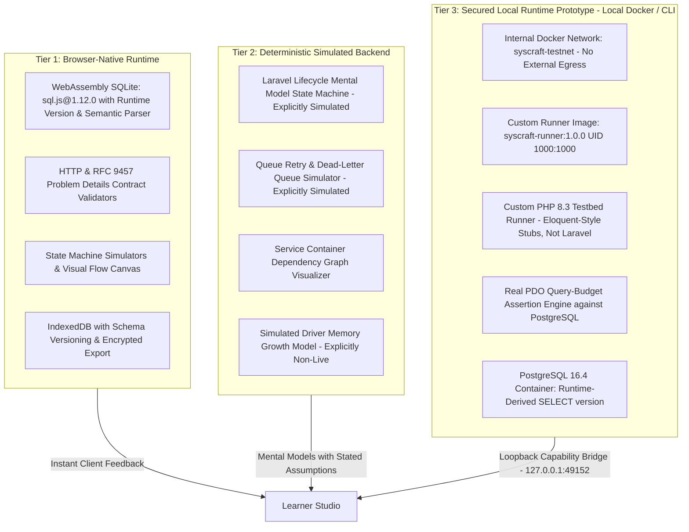
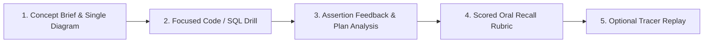

# SysCraft: Interactive Systems & Backend Learning Studio

> **Positioning Statement:**
> *SysCraft is a browser-first learning studio with deterministic simulations for systems concepts, semantic query-plan validation, and a secured local runtime integration that validates behavior against pinned PostgreSQL 16.4 with a deterministic PHP query-budget testbed prototype.*

---

## 1. Target Audience & Scope

SysCraft is engineered specifically for **self-directed backend engineers** preparing for:

* **Senior Backend & Systems Design Interviews:** Deep architectural trade-offs, backpressure handling, cursor vs. offset pagination, and unscripted oral defense.
* **Laravel / PHP Technical Roles:** Framework internals, HTTP request lifecycle, Service Container resolution, Eloquent N+1 elimination, and Horizon queue semantics.
* **Malaysian Government & GovTech Technical Assessments:** Conformance with official public sector digital standards (**MYDS - Malaysia Government Design System**), WCAG 2.2 accessibility, clean repository hygiene, threat-modeled authorization policies, and reproducible deployments.
* **Practical Engineering Evaluation:** Hands-on mastery of relational databases, query-plan optimization, session security, and deployment hygiene.

*Note: While SysCraft's progressive workflow accommodates structured onboarding, it is not a general-purpose tutorial platform for novice programmers. It assumes baseline familiarity with backend programming and focuses on senior-level conceptual depth and interview readiness.*

---

## 2. Core Architectural Philosophy: The 3-Tier Execution Model

A browser-only sandbox cannot replicate Zend engine memory internals, PDO driver buffering, or framework state. SysCraft enforces technical honesty by dividing all learning tasks into three explicit tiers:



* **Tier 1 (Browser-Native):** Runs in-browser via WebAssembly (`sql.js@1.12.0`). Evaluates SQLite query plans semantically, tests JSON/HTTP contracts against **RFC 9457 (Problem Details)**, and persists progress locally in IndexedDB.
* **Tier 2 (Simulated Backend):** Explicitly labeled as **"Deterministic Simulation"**. Visualizes abstract flows (request lifecycle, queue retry backoff, container bindings) using inspectable rules and documented assumptions rather than claiming live execution.
* **Tier 3 (Secured Local Runtime Prototype):** Standardized local Docker project or native CLI fallback. Validates code in an isolated **PHP 8.3.11 / PostgreSQL 16.4** testbed prototype with real PDO query-budget evaluation, connected via an isolated internal network (`syscraft-testnet`). The runner (`testbed/artisan`) is a custom PHP script using Eloquent-style stubs (`testbed/bootstrap/models.php`); its output mimics `php artisan test` / Pest formatting, but neither Laravel nor Pest is installed. Full canonical Laravel 12 framework booting & Pest test suite integration is planned for upcoming expansion.

---

## 3. Cognitive Load Control: The Progressive 5-Step Workflow

To eliminate split-screen cognitive overload, exercises flow through a focused sequential structure:



1. **Step 1: Concept Brief & Single Diagram:** Clean focus on the mental model (e.g. single diagram of B-Tree seek vs. sequential scan).
2. **Step 2: Focused Drill:** The code or query editor takes primary focus with clear instructions and query budgets.
3. **Step 3: Feedback & Plan Analysis:** Structural assertions evaluate query plans or code ASTs, highlighting *why* an index was skipped or *why* an authorization check failed.
4. **Step 4: Scored Oral Recall Rubric:** Timed, unscripted verbal practice against an explicit 5-dimension rubric (Correctness, Trade-Off Awareness, Failure Handling, Communication Clarity, Follow-Up Challenge).
5. **Step 5: Optional Tracer Replay:** Playback the request path or pipeline state machine to consolidate the mental model.

---

## 4. Development Roadmap

### Phase 0: Scaffolding, Git Init & MYDS Proof-of-Installation (Completed)

* [X] Initialize Git repository at `/home/nian014/projects/syscraft` with conventional commit structure.
* [X] Scaffold Vite 8.3.4 + React 19.3.0 (TypeScript 6.0.3) project.
* [X] Install pinned `@govtechmy/myds-react@1.0.2` and `@govtechmy/myds-style@1.0.0`.
* [X] Configure `.agents/` customizations directory (`rules/`, `skills/`, `notes/`) for cross-device development.
* [X] Gate Check: Verify MYDS component rendering, CSS design tokens, dark/light theme switching, and local SQLite WASM execution (`3.45.2`).

### Phase 1: MVP Core & Sequential Task Tracking (Completed & Hardened)

* [X] **Studio Shell:** Draggable 5-step progressive workflow UI using `react-resizable-panels`, Monaco Editor (`@monaco-editor/react`), and lazy-loaded React Flow (`@xyflow/react`).
* [X] **Two-Tier Task Tracking Architecture:** Macroscopic task catalog for Weeks 1–7 with microscopic 5-step FSM (`CurriculumTask`, `TaskStatus`, `TaskState`).
* [X] **Strict Sequential Step Gating:** Locked-step progression preventing skipping; Step 2 requires concept reading, Step 3 requires passing assertions, Step 4 requires confirming analysis, and Step 5 requires oral rubric scoring.
* [X] **Non-Destructive Module Switching:** Real-time auto-saving and IndexedDB v2 persistence (`tasks` and `drillSessions` stores) preserving learner draft code, active steps, and completions across module navigation.
* [X] **Week 1 Simulator (Tier 2):** Deterministic Laravel Lifecycle mental model tracer with interactive breakpoint inspection.
* [X] **Week 4 Database Lab (Tier 1):** `sql.js@1.12.0` SQLite sandbox with dynamic runtime version display (`sqlite3_libversion()`), reset scaffold starter, and fixture-tested semantic query-plan parser.
* [X] **Secured Local Bridge & Testbed Prototype (Tier 3):** Loopback bridge daemon (`127.0.0.1:49152`) connecting to `syscraft-testnet` with custom `syscraft-runner:1.0.0` and `postgres:16.4-alpine`, hardened with read-only rootfs, ephemeral learner code injection, real PDO query-budget tracking against PostgreSQL (51 unoptimized queries vs 3 batch eager-loaded queries), strict non-empty origin validation, and child process group timeout management.
* [X] **Oral Recall Rubric & Operationalized Hesitation Queue:** 5-dimension scored rubric (1–4 scale), latency/retry metrics, and Sunday review queue in IndexedDB.

### Phase 2: High-Value Core Expansions & Home Hub (Completed & Hardened)

#### Phase 2A: Learner-First Home Hub & Architectural Separation (Completed & Hardened)

* [X] **Learner-First Home Hub & Three-Node Navigation:** Outcome-driven homepage leading with clear core learning tracks (Framework Internals, Database Engineering, Distributed Queues, Architecture & Security), streamlined telemetry metrics, zero-secrets JSON envelope import/export, WCAG 2.2 AA reset confirmation modal, and persistent theme switching across `Curriculum`, `How It Works`, and `Studio Workbench` views.
* [X] **Dedicated "How It Works" Architectural View:** Dedicated technical transparency view separating runtime execution details (Tier 1 WASM SQLite, Tier 2 Simulation FSM, Tier 3 loopback Docker bridge at `127.0.0.1:49152`) and live container diagnostics from learner curriculum discovery.
* [X] **Desktop Viewport & Layout Sizing Hardening:** Enforced flex-shrink invariants (`.home-main > * { flex-shrink: 0; }`) preventing hero banner and dashboard card squishing, guaranteeing full typography legibility, comfortable tag/button spacing, and smooth scrolling across viewports.

#### Phase 2B: High-Value Core Expansions & Multi-Module Architecture (Completed & Hardened)

* [X] **Week 7 Timed CRUD & Auth Sprint:** 90-minute timed mock featuring accessible WCAG 2.2 polite milestone announcements, session fixation defense (`$request->session()->regenerate()`), IDOR prevention with policy authorization (`$this->authorize('update', $record)`), 5-dimension oral rubric, and dual verification (Tier 2 in-browser AST evaluation and Tier 3 Docker bridge runner).
* [X] **Week 6 System Design & STAR Defense:** High-throughput Weather Data Ingestion Pipeline (100k req/s), interactive `StarStoryBuilder` with 2 structured production incident scenarios (Buffer backpressure saturation & replication lag), Markdown RFC engineering document generator, and automated systems schema evaluator.
* [X] **Baseline Normalization & Multi-Module Registry:** Resolved legacy Week 4 ID inconsistencies (`w4-data-layer-indexes` → `w4-btree-indexing`) with backward-compatible IndexedDB session aliasing, and established a generalized `DRILL_REGISTRY` supporting non-destructive state persistence across Weeks 1, 4, 6, and 7.

### Phase 3: Enrichment Modules (Weeks 2, 3, 5) (Completed & Hardened)

* [X] **Week 2:** REST API cursor pagination with concurrency contracts & RFC 9457 Problem Details error formats.
* [X] **Week 3:** Refactoring diff studio with dependency injection, IoC container bindings, and Docker test harness.
* [X] **Week 5:** Resilient multi-queue ingestion pipeline, exponential backoff, and dead-letter queue isolation.

---

## 5. Further Enhancements: Stack-Adaptable Architecture

While SysCraft's initial curriculum focuses on Laravel, PHP, and PostgreSQL, its underlying learning framework is fundamentally **stack-adaptable**. The platform separates portable learning mechanics from stack-specific execution:

### 5.1 Portable Learning Layer vs. Stack-Specific Layer

| Dimension                     | Portable Layer (Core Platform)                                                                            | Stack-Specific Layer (Adapter Module)                     |
| ----------------------------- | --------------------------------------------------------------------------------------------------------- | --------------------------------------------------------- |
| **Learning Workflow**   | Concept $\rightarrow$ Drill $\rightarrow$ Feedback $\rightarrow$ Oral Recall $\rightarrow$ Review | Language/runtime syntax and toolchains                    |
| **Hesitation Tracking** | Action latency, retry counts, hint tracking, rubric misses                                                | Language-specific compilation & linter errors             |
| **System Design**       | URL shorteners, ingestion pipelines, notification systems                                                 | High-level architectural diagrams & trade-offs            |
| **API Contracts**       | Pagination mechanics, idempotency keys, RFC 9457 contracts                                                | Routing frameworks (Laravel, FastAPI, Express, Spring)    |
| **Database Concepts**   | B-Tree indexing, table scans vs. seeks, transaction safety                                                | Engine specifics (PostgreSQL, SQLite, MySQL, SQL Server)  |
| **Simulations**         | Deterministic state machines and animated visual tracers                                                  | Framework lifecycle nodes (Kernel, Middleware, Container) |

### 5.2 Stack Adapter Interface Architecture

Future releases can swap or extend the backend runtime by implementing a standardized **Stack Adapter Interface**:

> Target layout for the adapter architecture. It does not describe the current `src/` structure.

```text
Core Learning Platform
├── lessons/                        # Conceptual briefs, guidelines, and schemas
├── drills/                         # Drill definitions, budgets, and criteria
├── rubrics/                        # 5-dimension oral defense scoring models
├── tracking/                       # Hesitation metrics and Sunday review queues
├── persistence/                    # IndexedDB envelope & prototype-safe exports
├── simulations/                    # Abstract state machines & visual tracers
└── runtime/
    └── StackAdapterInterface.ts    # Contract for test execution & AST evaluation

Stack Adapters (Modular Plugins)
├── adapters/laravel/               # Planned reference: PHP 8.3 + Laravel 12 + Pest 3 (current Tier 3 is the custom testbed runner)
├── adapters/django/                # Future: Python 3.12 + Django 5 + Pytest
├── adapters/spring/                # Future: Java 21 + Spring Boot 3 + JUnit 5
├── adapters/nestjs/                # Future: Node 22 + NestJS 10 + Prisma + Jest
└── adapters/golang/                # Future: Go 1.23 + Gin/Echo + GORM + Go Test
```

### 5.3 Implementation Sequencing Strategy

1. **Reference Implementation (Current):** Build and harden the PHP 8.3 / PostgreSQL 16 testbed prototype first, then promote it to a full Laravel 12 reference system. Ensure that lesson schemas, drill models, rubric scoring, IndexedDB storage, and loopback bridge protocols are robust and battle-tested.
2. **Adapter Decoupling:** Keep curriculum content and prompt templates strictly separated from Laravel-specific execution details.
3. **Pluggable Adapters:** Once the core platform is proven, introduce new stack adapters behind the `StackAdapterInterface` without touching the studio shell, visual flow engine, or hesitation tracker.

---

## 6. Pinned Technology Stack Matrix

| Component                     | Pinned Version / Digest                                                                    |
| ----------------------------- | ------------------------------------------------------------------------------------------ |
| **Frontend Framework**  | React `19.3.0` + TypeScript `6.0.3` + Vite `8.3.4`                                   |
| **Design System**       | `@govtechmy/myds-react@1.0.2` & `@govtechmy/myds-style@1.0.0`                          |
| **Visual Tracer**       | `@xyflow/react` (`12.12.0`)                                                            |
| **IDE & Diff Editor**   | `@monaco-editor/react` (`4.7.0`)                                                       |
| **Tier 1 Database**     | `sql.js@1.12.0` (SQLite `3.45.2` WASM)                                                 |
| **Tier 3 Runner Image** | `syscraft-runner:1.0.0` (`php:8.3.11-cli-alpine` + Composer `2.7.7` + `pdo_pgsql`) |
| **Tier 3 Database**     | `postgres:16.4-alpine`                                                                   |
| **Tier 3 Framework**    | None yet: custom runner `testbed/artisan` with Eloquent-style stubs. Planned: Laravel `12.0.1` + PHPUnit `11.3.3` + Pest `3.0.4` |

---

## 7. Local Development Quickstart

### Prerequisites

* Node.js v20.x or v22.x LTS
* Docker Engine & Docker Compose v2.20+ (for Tier 3 exercises)

### 1. Start the Studio Development Server

```bash
git clone <repo-url> syscraft
cd syscraft
npm install
npm run dev
```

Open [http://localhost:5173](http://localhost:5173) in your browser.

### 2. Start the Tier 3 Docker Environment & Bridge Daemon

```bash
# In terminal 1: start internal PostgreSQL container
docker compose -f docker/docker-compose.yml up -d postgres

# In terminal 2: start loopback capability bridge daemon
npm run bridge
```

### 3. Verify Local Build & Linter

```bash
npm run lint
npm run build
```

---

## 8. License & Standards

* Built in alignment with the **Malaysia Government Design System (MYDS)** standards.
* Conforms to **WCAG 2.2 AA** accessibility guidelines.
