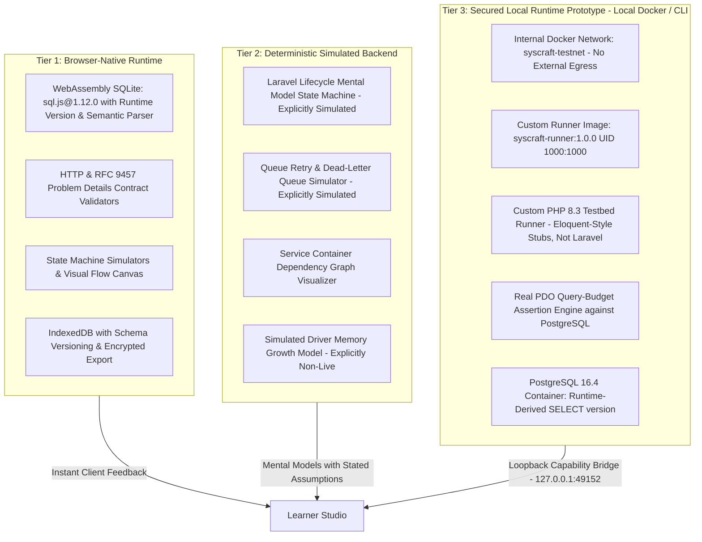
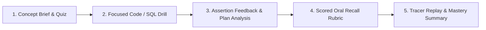

# SysCraft: Interactive Systems & Backend Learning Studio

> **Positioning Statement:**
> *SysCraft is a browser-first learning studio with deterministic simulations for systems concepts, semantic query-plan validation, and a secured local runtime integration that validates behavior against pinned PostgreSQL 16.4 with a deterministic PHP query-budget testbed prototype.*

---

## 1. Target Audience & Scope

SysCraft is engineered specifically for **self-directed backend engineers** preparing for:

* **Senior Backend & Systems Design Interviews:** Deep architectural trade-offs, backpressure handling, cursor vs. offset pagination, and unscripted oral defense.
* **Laravel / PHP Technical Roles:** Framework internals, HTTP request lifecycle, Service Container resolution, Eloquent N+1 elimination, and Horizon queue semantics.
* **Malaysian Government & GovTech Technical Assessments:** Conformance with official public sector digital standards (**MYDS - Malaysia Government Design System**), WCAG 2.2 accessibility, clean repository hygiene, threat-modeled authorization policies, and reproducible deployments.
* **Practical Engineering Evaluation:** Hands-on mastery of relational databases, query-plan optimization, session security, and deployment hygiene.

*Note: While SysCraft's progressive workflow accommodates structured onboarding, it is not a general-purpose tutorial platform for novice programmers. It assumes baseline familiarity with backend programming and focuses on senior-level conceptual depth and interview readiness.*

---

## 2. Core Architectural Philosophy: The 3-Tier Execution Model

A browser-only sandbox cannot replicate Zend engine memory internals, PDO driver buffering, or framework state. SysCraft enforces technical honesty by dividing all learning tasks into three explicit tiers:



* **Tier 1 (Browser-Native):** Runs in-browser via WebAssembly (`sql.js@1.12.0`). Evaluates SQLite query plans semantically, tests JSON/HTTP contracts against **RFC 9457 (Problem Details)**, and persists progress locally in IndexedDB.
* **Tier 2 (Simulated Backend):** Explicitly labeled as **"Deterministic Simulation"**. Visualizes abstract flows (request lifecycle, queue retry backoff, container bindings) using inspectable rules and documented assumptions rather than claiming live execution.
* **Tier 3 (Secured Local Runtime Prototype):** Standardized local Docker project or native CLI fallback. Validates code in an isolated **PHP 8.3.11 / PostgreSQL 16.4** testbed prototype with real PDO query-budget evaluation, connected via an isolated internal network (`syscraft-testnet`). The runner (`testbed/artisan`) is a custom PHP script using Eloquent-style stubs (`testbed/bootstrap/models.php`); its output mimics `php artisan test` / Pest formatting, but neither Laravel nor Pest is installed. Full canonical Laravel 12 framework booting & Pest test suite integration is planned for upcoming expansion.

---

## 3. Cognitive Load Control: The Progressive 5-Step Workflow

To eliminate split-screen cognitive overload, exercises flow through a focused sequential structure:



1. **Step 1: Concept Brief & Diagnostic Quiz:** Focuses on the core mental model with visual dataflow schematics and an interactive diagnostic check to test baseline architectural intuition before writing code.
2. **Step 2: Focused Drill:** The code or query editor takes primary focus with clear instructions, query budgets, non-punitive progressive hints, and starter reset scaffolds.
3. **Step 3: Feedback & Plan Analysis:** Structural assertions evaluate query plans or code ASTs, highlighting *why* an index was skipped, *why* an authorization check failed, or whether query count budgets were exceeded.
4. **Step 4: Scored Oral Recall Rubric:** Timed, unscripted verbal defense against an explicit 5-dimension rubric (Correctness, Trade-Off Awareness, Failure Handling, Communication Clarity, Follow-Up Challenge).
5. **Step 5: Tracer Replay & Mastery Summary:** Consolidates learning with an interactive visual state machine tracing the runtime path, concluding with a celebratory drill mastery summary and active frontier routing.

---

## 4. Active Curriculum Catalog

SysCraft ships with 7 structured, production-grounded weeks spanning 4 core backend domains:

| Week | Module & Title | Tier & Engine | Focus Topics & Contract |
| :--- | :--- | :--- | :--- |
| **Week 1** | **Laravel Request Lifecycle & Eloquent N+1 Elimination** | **Tier 2**<br>`simulated-laravel` | • 9-stage HTTP ingress pipeline<br>• Eloquent eager loading (`with`)<br>• Query budget enforcement ($\le 3$ queries)<br>• `Model::preventLazyLoading` |
| **Week 2** | **REST Cursor Pagination & RFC 9457 Problem Details** | **Tier 1**<br>`wasm-sqlite` | • Seek-based cursor pagination (`WHERE (created_at, id) < (...)`)<br>• Eliminating high-offset table scans<br>• RFC 9457 Problem Details standard error responses<br>• Opaque base64 cursor tokens |
| **Week 3** | **Class Refactoring, Service Container & Dependency Injection** | **Tier 3**<br>`docker-postgres` | • Extracting procedural business logic into focused services<br>• Interface contracts & constructor injection<br>• Service Provider bindings in Laravel IoC<br>• Real container test execution |
| **Week 4** | **B-Tree Compound Indexing & EXPLAIN QUERY PLAN Lab** | **Tier 1**<br>`wasm-sqlite` | • Composite B-Tree index column ordering (equality vs. range)<br>• Semantic query plan analysis (`SEARCH TABLE ... USING INDEX`)<br>• Avoiding full sequential table scans<br>• Covering indexes for zero-table-lookup reads |
| **Week 5** | **Resilient Queue Ingestion & Dead-Letter Backoff Pipeline** | **Tier 2**<br>`simulated-laravel` | • Idempotent message consumption<br>• Exponential backoff jitter retry policies<br>• Poison message isolation via Dead-Letter Queue (DLQ)<br>• Worker starvation and memory leak mitigation |
| **Week 6** | **Weather Data Pipeline & STAR Architecture Defense** | **Tier 1**<br>`wasm-sqlite` | • High-throughput sensor ingestion (100k req/s)<br>• Buffer backpressure and time-series sharding trade-offs<br>• Interactive STAR (Situation, Task, Action, Result) defense builder<br>• Incident postmortem & production RFC generation |
| **Week 7** | **Session Fixation Defense & Policy Authorization Gate** | **Tier 3**<br>`docker-postgres` | • Session fixation defense (`$request->session()->regenerate()`)<br>• Zero-trust model policy authorization (`$this->authorize(...)`)<br>• Insecure Direct Object Reference (IDOR) prevention<br>• 25-minute timed mock sprint against multi-tenant models |

---

## 5. Platform Architecture & Capabilities

### 5.1 Learner Hub & Adaptive Navigation
* **Frontier CTA Resolver:** Automatically evaluates learner prerequisites, completion state, and in-progress work to route the learner directly to their active frontier drill.
* **Architecture Transparency View:** Dedicated technical dashboard detailing runtime execution invariants, container health diagnostics, and bridge status.
* **Hesitation & Spaced Review Tracking:** Telemetry records action latency, retry attempts, hint accesses, and oral rubric misses to populate an operationalized review queue.
* **Zero-Secrets Data Hygiene:** IndexedDB v2 persistence with validated schema versioning, prototype-pollution defenses, and safe JSON import/export envelopes.

### 5.2 Design System & Accessibility
* Built with official **Malaysia Government Design System (MYDS)** primitives (`@govtechmy/myds-react@1.0.2` and `@govtechmy/myds-style@1.0.0`).
* Fully accessible under **WCAG 2.2 AA** guidelines with semantic radio groups, 3px high-visibility focus indicators, and screen-reader announcements.
* Harmonious dark and light themes with tactile elevation, spatial depth, and responsive desktop layout sizing.

---

## 6. Future Expansion: Stack-Adaptable Architecture

While SysCraft's initial curriculum focuses on Laravel, PHP, and PostgreSQL, its underlying learning framework is fundamentally **stack-adaptable**. The platform separates portable learning mechanics from stack-specific execution:

### 6.1 Portable Learning Layer vs. Stack-Specific Layer

| Dimension | Portable Layer (Core Platform) | Stack-Specific Layer (Adapter Module) |
| :--- | :--- | :--- |
| **Learning Workflow** | Concept $\rightarrow$ Drill $\rightarrow$ Feedback $\rightarrow$ Oral Recall $\rightarrow$ Review | Language/runtime syntax and toolchains |
| **Hesitation Tracking** | Action latency, retry counts, hint tracking, rubric misses | Language-specific compilation & linter errors |
| **System Design** | Ingestion pipelines, sharding, caching, STAR defense | Framework-specific architectural boilerplates |
| **API Contracts** | Pagination mechanics, idempotency keys, RFC 9457 contracts | Routing frameworks (Laravel, FastAPI, Express, Spring, Go) |
| **Database Concepts** | B-Tree indexing, table scans vs. seeks, transaction safety | Engine specifics (PostgreSQL, SQLite, MySQL, SQL Server) |
| **Simulations** | Deterministic state machines and animated visual tracers | Framework lifecycle nodes (Kernel, Middleware, Container) |

### 6.2 Stack Adapter Interface Architecture

Future releases can swap or extend the backend runtime by implementing a standardized **Stack Adapter Interface**:

> Target layout for the adapter architecture. It does not describe the current `src/` structure.

```text
Core Learning Platform
├── lessons/                        # Conceptual briefs, guidelines, and schemas
├── drills/                         # Drill definitions, budgets, and criteria
├── rubrics/                        # 5-dimension oral defense scoring models
├── tracking/                       # Hesitation metrics and review queues
├── persistence/                    # IndexedDB envelope & prototype-safe exports
├── simulations/                    # Abstract state machines & visual tracers
└── runtime/
    └── StackAdapterInterface.ts    # Contract for test execution & AST evaluation

Stack Adapters (Modular Plugins)
├── adapters/laravel/               # Planned reference: PHP 8.3 + Laravel 12 + Pest 3 (current Tier 3 is the custom testbed runner)
├── adapters/django/                # Future: Python 3.12 + Django 5 + Pytest
├── adapters/spring/                # Future: Java 21 + Spring Boot 3 + JUnit 5
├── adapters/nestjs/                # Future: Node 22 + NestJS 10 + Prisma + Jest
└── adapters/golang/                # Future: Go 1.23 + Gin/Echo + GORM + Go Test
```

### 6.3 Implementation Sequencing Strategy

1. **Reference Implementation (Current):** Build and harden the PHP 8.3 / PostgreSQL 16 testbed prototype first, then promote it to a full Laravel 12 reference system. Ensure that lesson schemas, drill models, rubric scoring, IndexedDB storage, and loopback bridge protocols are robust and battle-tested.
2. **Adapter Decoupling:** Keep curriculum content and prompt templates strictly separated from Laravel-specific execution details.
3. **Pluggable Adapters:** Introduce new stack adapters (e.g. Django, Spring, Go) behind the `StackAdapterInterface` without touching the studio shell, visual flow engine, or hesitation tracker.

---

## 7. Pinned Technology Stack Matrix

| Component | Pinned Version / Digest | Purpose |
| :--- | :--- | :--- |
| **Frontend Framework** | React `19.3.0` + TypeScript `6.0.3` + Vite `8.3.4` | Studio UI and state management |
| **Design System** | `@govtechmy/myds-react@1.0.2` & `@govtechmy/myds-style@1.0.0` | Accessible Malaysian design system |
| **Visual Tracer** | `@xyflow/react` (`12.12.0`) | Interactive step-5 runtime tracers |
| **IDE & Diff Editor** | `@monaco-editor/react` (`4.7.0`) | Workbench code and query editing |
| **Tier 1 Database** | `sql.js@1.12.0` (SQLite `3.45.2` WASM) | Offline in-browser database execution |
| **Tier 3 Runner Image** | `syscraft-runner:1.0.0` (`php:8.3.11-cli-alpine` + Composer `2.7.7`) | Isolated container code execution |
| **Tier 3 Database** | `postgres:16.4-alpine` | Real PostgreSQL database testbed |
| **Tier 3 Runner** | Custom runner `testbed/artisan` with Eloquent-style stubs | Query-budget assertion engine |

---

## 8. Local Development Quickstart

### Prerequisites

* Node.js v20.x or v22.x LTS
* Docker Engine & Docker Compose v2.20+ (for Tier 3 exercises)

### Start and stop all services (WSL/Linux)

Load your Node environment (for NVM: `source ~/.nvm/nvm.sh`), enable Docker Desktop integration for your WSL distribution, and install dependencies once with `npm ci`. Commands below run from the repository root:

```bash
npm run start:all
npm run stop:all
```

Start runs PostgreSQL, the bridge, and Vite in the background, building the PHP runner image if missing. Open http://localhost:5173 after readiness succeeds. The runner itself runs only during exercises. Logs are in `.syscraft/bridge.log` and `.syscraft/vite.log`.

Stop preserves PostgreSQL data by stopping its container without removing it. Do not remove that container if you need its data. Repeated commands are safe; occupied ports or an independently started PostgreSQL require stopping their owner first. A failed startup rolls back services it started. If cleanup fails, retry `npm run stop:all`. A lock prevents concurrent lifecycle commands; runtime state and logs are local and ignored by Git.

### 1. Start the Studio Development Server

```bash
git clone <repo-url> syscraft
cd syscraft
npm install
npm run dev
```

Open [http://localhost:5173](http://localhost:5173) in your browser.

### 2. Start the Tier 3 Docker Environment & Bridge Daemon

```bash
# In terminal 1: start internal PostgreSQL container
docker compose -f docker/docker-compose.yml up -d postgres

# In terminal 2: start loopback capability bridge daemon
npm run bridge
```

### 3. Verify Local Build & Test Suite

```bash
npm run lint
npm test
npm run build
```

---

## 9. License & Standards

* Built in alignment with the **Malaysia Government Design System (MYDS)** standards.
* Conforms to **WCAG 2.2 AA** accessibility guidelines.
